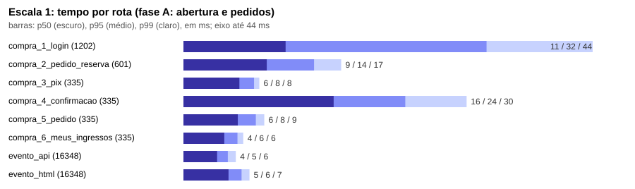
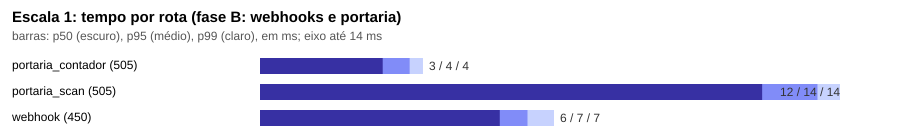
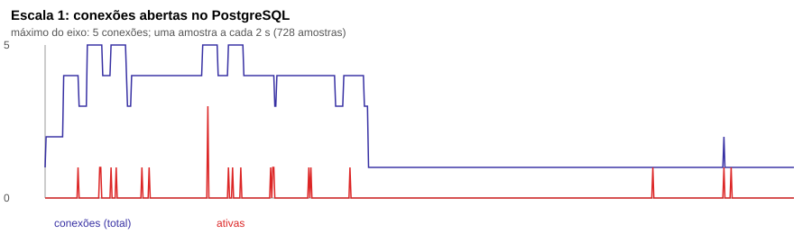
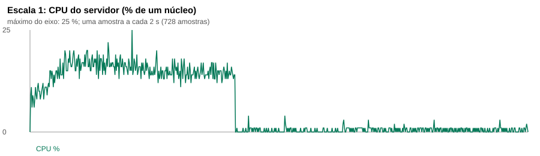
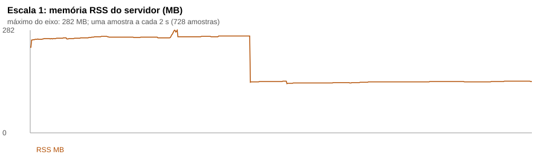

# Carga da auditoria, escala 1 (2026-10-19 06:02 UTC)

Servidor local empacotado (dist-server), heap de 320 MB, `DB_POOL_MAX=5`, gateway fictício; PostgreSQL de teste em Docker. k6 1.0.0. Fase A k6 exit=0; fase B k6 exit=0 (exit 99 = algum limiar estourado, veja as tabelas).

Semente: capacidade 500 ingressos; 800 compradores. pedidos pagos: 335; ingressos válidos: 500; pendentes: 0

## Resultado das compras (fase A)

| Métrica | Valor |
|---|---|
| Compras iniciadas | 601 |
| Compras concluídas (pagas, com ingresso) | 335 |
| Recusadas por estoque (esperado ao esgotar) | 266 |
| Erros inesperados | 0 |
| Requisições HTTP com falha (fase A) | 0.74% |
| Compra completa, p95 | 3912 ms |
| Tempo até o primeiro byte da página do evento, p50 / p95 / p99 | 5 ms / 6 ms / 7 ms |
| Usuários virtuais máximos (fase A) | 330 |

## Webhooks e portaria (fase B)

| Métrica | Valor |
|---|---|
| Webhooks válidos (200) | 450 |
| Webhooks com assinatura inválida (401, esperado) | 50 |
| Webhooks com erro | 0 |
| Leituras na portaria | 505 (válidas 459, já utilizado 46, erro 0) |
| Requisições HTTP com falha (fase B, inclui os 401 esperados) | 3.30% |

## Tempo por rota (ms)

| Fase | Rota | Requisições | p50 | p95 | p99 | máx |
|---|---|---|---|---|---|---|
| A | compra_1_login | 1202 | 11 | 32 | 44 | 102 |
| A | compra_2_pedido_reserva | 601 | 9 | 14 | 17 | 47 |
| A | compra_3_pix | 335 | 6 | 8 | 8 | 16 |
| A | compra_4_confirmacao | 335 | 16 | 24 | 30 | 45 |
| A | compra_5_pedido | 335 | 6 | 8 | 9 | 14 |
| A | compra_6_meus_ingressos | 335 | 4 | 6 | 6 | 7 |
| A | evento_api | 16348 | 4 | 5 | 6 | 27 |
| A | evento_html | 16348 | 5 | 6 | 7 | 32 |
| B | portaria_contador | 505 | 3 | 4 | 4 | 4 |
| B | portaria_scan | 505 | 12 | 14 | 14 | 21 |
| B | webhook | 450 | 6 | 7 | 7 | 8 |

## Recursos do servidor e do banco

| Medida | Valor |
|---|---|
| Conexões abertas no PostgreSQL, máximo (p95) | 5 (5) |
| Conexões ativas, máximo | 3 |
| CPU do processo, máximo (p95) | 25% (18%) |
| Memória RSS, máximo | 282 MB |

## Fila de e-mails (captura local, sem SMTP)

| E-mails | Enviados | Falhou | Tempo na fila p50 | p95 | máx |
|---|---|---|---|---|---|
| 335 | 335 | 0 | 0.01 s | 0.01 s | 0.02 s |

## Invariantes depois da carga

| Invariante | Violações | Tempo |
|---|---|---|
| 1. Ingressos emitidos (não cancelados) nunca acima da capacidade do tipo | nenhuma | 7 ms |
| 2. Vendidos registrados no tipo nunca acima da capacidade | nenhuma | 1 ms |
| 3. Vendidos mais reservas ativas dentro do prazo nunca acima da capacidade | nenhuma | 3 ms |
| 4. Todo pedido pago tem exatamente a quantidade de ingressos comprada | nenhuma | 4 ms |
| 5. Nenhum ingresso de pedido que nunca foi pago | nenhuma | 1 ms |
| 6. Nenhum QR, código ou código curto duplicado | nenhuma | 2 ms |
| 7. Nenhuma entrada válida duplicada por ingresso (uma primeira entrada só) | nenhuma | 2 ms |
| 8. Ingresso utilizado tem exatamente uma entrada válida; ingresso válido não tem entrada válida | nenhuma | 2 ms |
| 9. Vendidos do tipo iguais aos ingressos emitidos (inclusive cancelados, que não devolvem estoque) | nenhuma | 1 ms |
| 10. Lotes: soma das quantidades dos lotes igual à capacidade do tipo, e vendidos do lote dentro do lote | nenhuma | 1 ms |
| 11. Total do pedido igual aos itens mais a taxa de serviço | nenhuma | 1 ms |
| 12. Notificação do gateway processada só uma vez por id de evento | nenhuma | 1 ms |
| 13. Reserva ativa só em pedido pendente | nenhuma | 1 ms |
| 14. Ingresso transferido sempre com titular existente e ativo (ou anonimizado) | nenhuma | 1 ms |

Todas as invariantes conferem.
